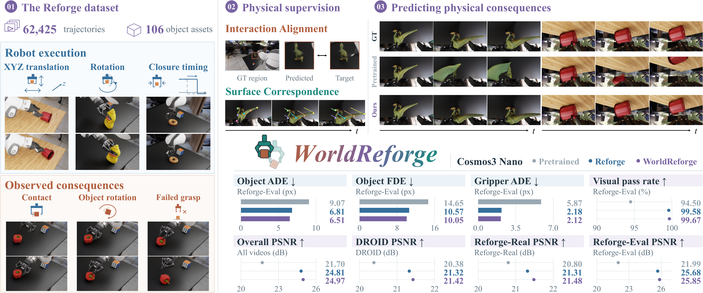

<p align="center">
  
</p>

<h2 align="center">
  Beyond the Happy Path:<br>
  Generalizing Robot World Models from Simulated Failures
</h2>

<p align="center">
  Zhiyue Zhao<sup>1,2,*</sup>,
  Mingyu Liu<sup>1,2,*</sup>,
  Bolin Zhang<sup>1</sup>,
  Liyang Li<sup>1</sup>,
  Guangyu Huang<sup>1</sup>,
  Canyu Zhao<sup>1</sup>,
  Jinchuan Shi<sup>1</sup>,<br>
  Haokai&nbsp;Zhang<sup>1</sup>,
  Hao Chen<sup>1,†</sup>,
  Chunhua Shen<sup>1,†</sup>
</p>

<p align="center">
  <sup>1</sup> Zhejiang University &nbsp;&nbsp;
  <sup>2</sup> Shanghai Innovation Institute<br>
  <sup>*</sup> Equal contribution. &nbsp;&nbsp;
  <sup>†</sup> Corresponding authors.
</p>

<p align="center">
  <a href="https://aim-uofa.github.io/WorldReforge/"></a>
  <a href="https://arxiv.org/abs/2611.33925"></a>
  <a href="https://huggingface.co/WorldReforge/Cosmos3-Nano-WorldReforge"></a>
  <a href="https://huggingface.co/datasets/WorldReforge/Reforge-Eval"></a>
</p>

<hr>

### Overview

Official code for **Beyond the Happy Path: Generalizing Robot World Models from
Simulated Failures**. **WorldReforge** teaches video world models to predict the
physical consequences of robot-object interactions through post-training on
simulated failures with physical supervision. This repository provides inference
and evaluation code for **Cosmos3 Nano WorldReforge** and the original pretrained
**Cosmos3 Nano** baseline.

<p align="center">
  
</p>

<hr>

### 📣 Updated News

- `[2026.11.26]` Our [paper](https://arxiv.org/abs/2611.33925) is available on arXiv.
- `[2026.11.26]` Release of the WorldReforge [inference and evaluation code](#evaluation).
- `[2026.11.26]` Release of [Reforge-Eval](https://huggingface.co/datasets/WorldReforge/Reforge-Eval).

<hr>

### Installation

Install WorldReforge in a CUDA-enabled [NVIDIA Cosmos Framework](https://github.com/NVIDIA/cosmos-framework)
environment with Cosmos3 Nano support:

```bash
python -m pip install -e .
```

Tested with Cosmos Framework 1.2.2, PyTorch 2.10.0 (CUDA 12.8),
Transformers 4.57.6, tokenizers 0.22.2, and huggingface-hub 0.36.0.

For motion metrics, install [CoTracker3](https://github.com/facebookresearch/co-tracker)
and its scaled offline checkpoint from the repository root:

```bash
mkdir -p third_party models
git clone https://github.com/facebookresearch/co-tracker.git third_party/co-tracker
python -m pip install -e third_party/co-tracker
curl --fail --location \
  --output models/cotracker3_offline.pth \
  https://huggingface.co/facebook/cotracker3/resolve/main/scaled_offline.pth
```

Skip the clone command if `third_party/co-tracker` already exists.

<hr>

### Model and Data

| Resource | Description | Status |
|---|---|---|
| Model | Cosmos3 Nano WorldReforge | [Hugging Face](https://huggingface.co/WorldReforge/Cosmos3-Nano-WorldReforge) |
| Pretrained model | Original Cosmos3 Nano | [NVIDIA checkpoint](https://huggingface.co/nvidia/Cosmos3-Nano) |
| Data | Reforge-Eval input images, measured states, reference videos, and motion labels | [Uploading to Hugging Face](https://huggingface.co/datasets/WorldReforge/Reforge-Eval) |

The [Reforge-Eval manifest](manifests/eval1200.jsonl) contains **1,200 simulation windows**,
each with one conditioning frame and 16 future frames.
See [Input format](docs/data_format.md) for file and state conventions, and
[artifacts.json](manifests/artifacts.json) for release information.

Place downloaded models, dependencies, and data in these directories:

```text
WorldReforge/
├── models/
│   ├── Cosmos3-Nano/
│   ├── nano-worldreforge/
│   ├── Wan2.2_VAE.pth
│   ├── Qwen3-VL-8B-Instruct-tokenizer/
│   └── cotracker3_offline.pth
├── data/
│   └── reforge-eval/
│       └── samples/
│           └── <id>/
├── third_party/
│   └── co-tracker/
└── outputs/
```

Keep each checkpoint's configuration, weight index, subdirectories, and shards together.
Both Nano models use the same VAE and **Qwen3-VL-8B-Instruct text tokenizer**;
only the tokenizer files are needed, not Qwen model weights.

<hr>

### Evaluation

With the files arranged as above, run WorldReforge inference and evaluation from the repository root:

```bash
bash scripts/evaluate.sh
```

Defaults are GPU 0, batch size 1, and 8 CPU scoring workers. Append CLI flags to
override paths or settings. For example, `bash scripts/evaluate.sh --gpu 1 --output outputs/run-2`
selects the second visible GPU and a fresh output directory. Use `--pixels-only` to skip tracking.

Metrics include object/gripper ADE and FDE, PSNR, SSIM, and pixel errors;
see [Evaluation metrics](docs/evaluation.md) for definitions and aggregation.

| Output | Contents |
|---|---|
| `inference/predictions/<id>/prediction.npy` | Lossless predicted frames |
| `evaluation/metrics/cases/` | Per-video metrics |
| `evaluation/metrics/summary.json` | Overall and subgroup averages |
| `evaluation/checks/results.json` | Coverage and consistency checks |

The run writes `COMPLETE.json` after validation, or stops with `FAILED.json` on failure.

**Original Nano baseline.** Generate predictions with the pretrained checkpoint:

```bash
bash scripts/infer_original.sh
```

This inference-only shortcut defaults to `models/Cosmos3-Nano/` and uses the same
inference settings as WorldReforge. For inference **and** evaluation, use the
`scripts/evaluate.sh` command above with
`--checkpoint models/Cosmos3-Nano` and `--output outputs/nano-original-eval`.

<hr>

### License

WorldReforge code is released under the [Apache License 2.0](LICENSE).
Third-party software, model weights, and datasets are governed by their respective
licenses.

<hr>

### Acknowledgments

We thank the teams behind [NVIDIA Cosmos Framework](https://github.com/NVIDIA/cosmos-framework),
[RoboLab](https://github.com/NVlabs/RoboLab), and
[CoTracker](https://github.com/facebookresearch/co-tracker)
for their open-source contributions.
